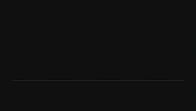
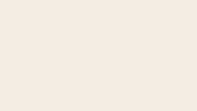
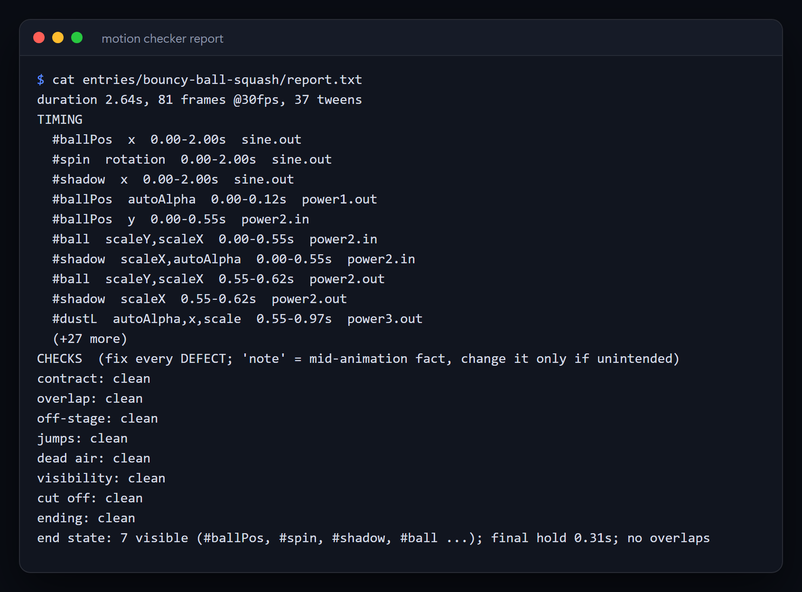

<p align="center">
  
</p>

<p align="center">
  
  
  
  
  
</p>

**A bank of 85 hand-reviewed GSAP animations, plus a renderer and motion checker, to test whether small local models animate better with examples and self-measurement.**

<table>
  <tr>
    <td align="center"><br><sub>squash and stretch</sub></td>
    <td align="center"><br><sub>anticipation, impact</sub></td>
    <td align="center"><br><sub>flip, stretch, wobble</sub></td>
  </tr>
  <tr>
    <td align="center"><br><sub>VS split template</sub></td>
    <td align="center"><br><sub>leaderboard swap template</sub></td>
    <td align="center"><br><sub>kinetic type</sub></td>
  </tr>
</table>

<sub>Six of the 85 entries in `entries/`. Each GIF is rendered frame by frame from that entry's `anim.html`.</sub>

## What it does

- Stores 85 animations. A human kept 61 and rejected the rest on taste.
- Gives every animation one [contract](CONTRACT.md): one `anim.html`, one paused GSAP timeline, no randomness.
- Renders each animation frame-exact into a filmstrip, an onion-skin image, and a text motion report.
- Checks motion mechanically: overlaps, off-stage, jumps, dead air, never-visible, cut-off, long final holds.
- Retrieves the 3 best-matching keepers as few-shot examples for a request.
- Runs a local OpenAI-compatible model (LM Studio) with optional repair rounds fed by the checker.
- Exports transparent overlays (ProRes 4444, VP9) and 9:16 vertical animations with safe-zone checks.

## Results

Experiment 1 is the only run so far. It was **inconclusive**.

- Model: Gemma 4 12B (local), 0-shot vs 3-shot, on 2 of 5 planned holdout prompts. Write-up: [docs/experiments/2026-10-23-gemma-baseline.md](docs/experiments/2026-10-23-gemma-baseline.md).
- Score: 1-1. Each prompt had one mode that worked and one that failed, so no 0-shot vs 3-shot conclusion follows.
- Examples transferred style: 3-shot fixed a `from()` misuse unprompted and copied contact shadows from a bank entry.
- Bad examples hurt: keyword retrieval matched topic words, so one 3-shot run copied unrelated templates.
- Repair rounds achieved nothing: the report never named the real bug, or the model never answered.
- 2 of 9 model calls spent the whole 12k-token budget on reasoning and returned no answer.
- The run exposed 3 checker blind spots. Each is frozen as a fixture in `fixtures/`.

<table>
  <tr><th></th><th>Claude (bank original, held out)</th><th>Gemma 4 12B (local)</th></tr>
  <tr>
    <td><b>record-stamp</b><br><sub>Gemma: 0-shot, first try</sub></td>
    <td></td>
    <td></td>
  </tr>
  <tr>
    <td><b>shape-drop-bounce</b><br><sub>Gemma: 3-shot, first try</sub></td>
    <td></td>
    <td></td>
  </tr>
</table>

<sub>The two rows are different prompts, so this is not a before/after. Source: `docs/media/experiments/`, described in the write-up above.</sub>

Caveats:

- The comparison uses 2 prompts and a single human judge.
- Gemma's record-stamp 0-shot was judged correct but bland and too quick.
- Experiment 2 (after the checker, runner and retrieval fixes) has not been run.

## How it works

```text
prompt -> retrieve.py (3 best keepers) -> local model -> anim.html
       -> render.py (frame-exact) -> filmstrip + onion + report.txt
       -> report defects (+ images) back to the model for repair   [--fix]
       -> gallery.py: human keep/reject -> keepers join the bank
```

The checker splits **defects** (wrong at rest, text covered, jumps, contract breaks) from **notes** (mid-animation facts).

- Repair rounds act only on defects.
- A noisy checker would teach a model to make timid motion for a clean report.

<p align="center">
  
</p>

<sub>`entries/bouncy-ball-squash/report.txt`, the checker output committed with the entry.</sub>

More views a model gets: [filmstrip](docs/media/filmstrip-jelly-cube-hop.png) and [onion skin](docs/media/onion-bouncy-ball-squash.png).

## Quick start

Needs ffmpeg on PATH and [uv](https://docs.astral.sh/uv/). Rendering needs Playwright Chromium. The local runner needs an OpenAI-compatible server (LM Studio on :1234).

```bash
git clone https://github.com/juxstin1/Text-2-Motion && cd Text-2-Motion
uv sync
uv run playwright install chromium
uv run tools/render.py --all          # about 7 min
uv run tools/gallery.py               # http://127.0.0.1:8765/
uv run tools/retrieve.py "ball drops in and squashes on landing" -k 3
uv run tools/run_local.py "<request>" --shots 3 --fix 2 --vision
uv run tools/test_checker.py          # checker regression tests
```

All commands and the report format: [docs/DETAILS.md](docs/DETAILS.md).

## Layout

- `entries/` : one folder per animation (`anim.html`, `prompt.txt`, `meta.json`, `report.txt`).
- `tools/` : renderer, checker, gallery, retrieval, local runner, experiment runner.
- `fixtures/` : checker regression cases with expected findings.
- `vendor/` : GSAP 3.15 and plugins, 12 fonts, style packs. Everything runs offline.
- `docs/` : details, experiment write-ups, README media.

## Status

- Works: bank, contract, renderer, motion report, gallery, retrieval, local runner with repair loop, checker suite.
- Open: occlusion-aware overlap check (scene transitions are false positives today).
- Checks for never-visible and cut-off elements are in `tools/render.py`, but Experiment 2 has not re-tested them.
- Next: Experiment 2 on fresh holdouts, then a VLM pilot predicting human keep/reject.
- Goal: 500+ keepers for a LoRA fine-tune.

## Third-party

- [GSAP](https://gsap.com) 3.15 and its plugins, vendored under the [standard no-charge license](https://gsap.com/standard-license).
- Fonts from Google Fonts under the SIL Open Font License.
- Brands in templates (Nova, Apex, Orbit, Quill, Kite) are made-up placeholders.
