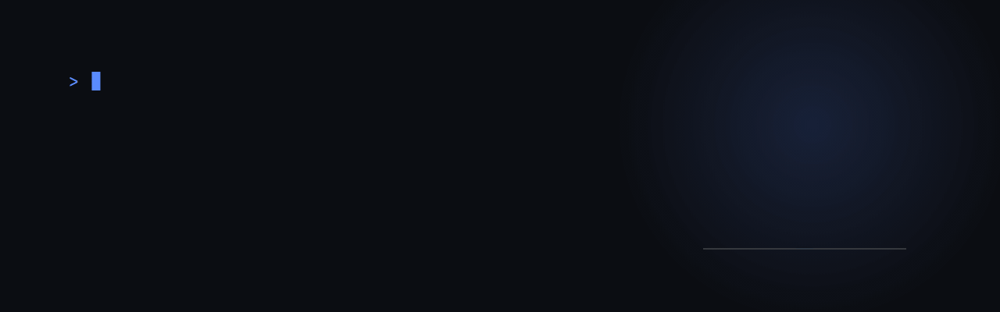
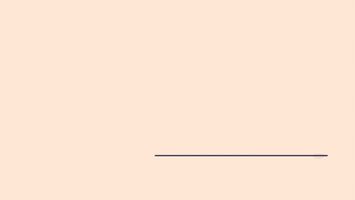
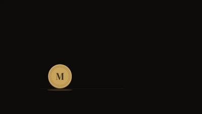
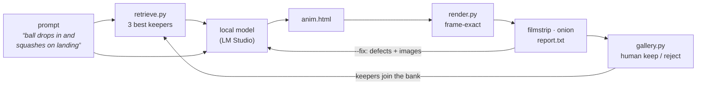
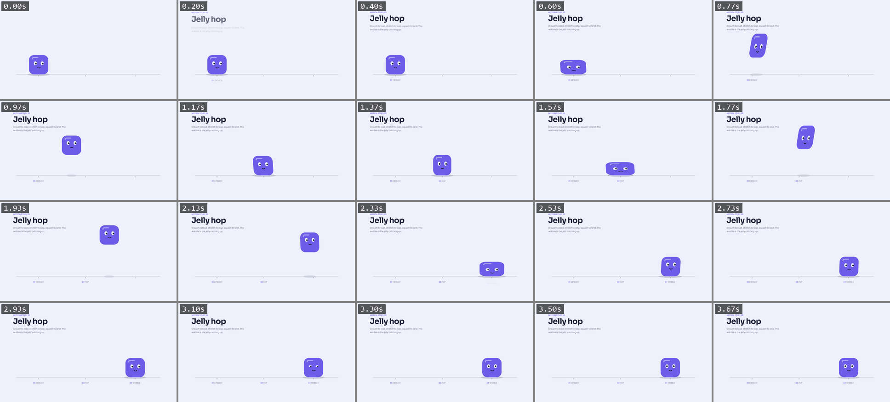
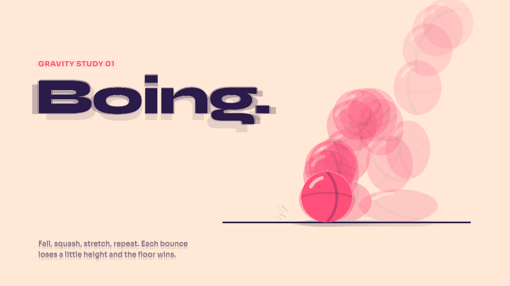
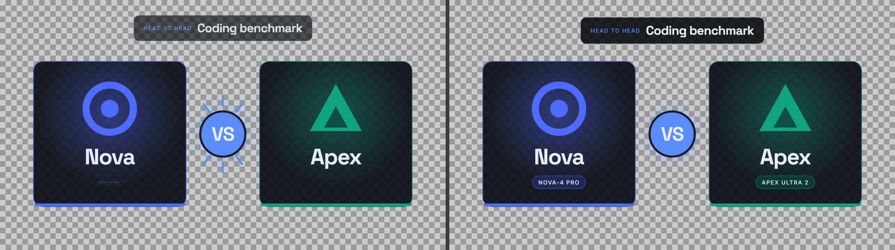
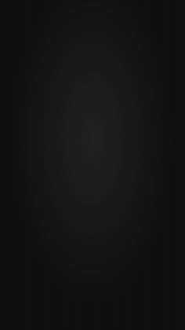

<p align="center">
  
</p>

<p align="center">
  
  
  
  
  
  
</p>

> Picking this up? Start with [HANDOFF.md](HANDOFF.md).

**Text-2-Motion** is a bank of hand-reviewed motion graphics, plus the tooling to teach a *small, local* model to make them: you type a sentence, and the model writes a polished, deterministic GSAP animation.

## The goal

Frontier models can already write good animation code. Small local models (a 7–32B Qwen coder on your own GPU) mostly can't: they produce stiff, linear, generic motion. This project tests a simple bet:

> **A small model gets much better at motion when it's shown the right examples and can measure its own output.**

Three pieces make that testable:

1. **A curated bank.** Every animation here was written by a strong model and then **kept or rejected by a human** on taste. Only keepers are used as examples, so the small model copies the good stuff, not the average.
2. **A renderer that turns motion into evidence a model can read.** Each animation is stepped frame-by-frame (no screen recording, no dropped frames) into a timestamped filmstrip, a motion-trail "onion" image, and a plain-text **motion report**: per-element timing, eases, collisions, jumps, dead air. A text model can't watch video, but it can read this.
3. **A closed loop.** `run_local.py` retrieves the 3 best-matching keepers as few-shot examples, asks the local model for a new animation, renders it, and can feed the report (and images, for vision models) back for repair rounds.

The first experiment: 5 held-out prompts, local model at **0-shot vs 3-shot**, judged by the same human taste. If 3-shot clearly wins, the bank is doing its job, and every new keeper (including the local model's own) makes the next run better. Longer term: enough keepers for a LoRA fine-tune.

## What's in the bank

<table>
  <tr>
    <td align="center"><br><sub><b>character</b> · squash &amp; stretch</sub></td>
    <td align="center"><br><sub><b>character</b> · anticipation, impact</sub></td>
    <td align="center"><br><sub><b>character</b> · flip, stretch, wobble</sub></td>
  </tr>
  <tr>
    <td align="center"><br><sub><b>template</b> · VS split (swap in any logos)</sub></td>
    <td align="center"><br><sub><b>template</b> · leaderboard swap</sub></td>
    <td align="center"><br><sub><b>kinetic type</b> · slam stack</sub></td>
  </tr>
</table>

| Category | Entries | Kept | What it is |
| --- | ---: | ---: | --- |
| Entrance | 20 | 15 | cards, buttons, panels, icons, logo marks |
| Text | 20 | 10 | headlines, counters, letter and word staggers |
| Character | 6 | 6 | squash and stretch, anticipation, follow-through |
| Transitions | 4 | 3 | iris, stripe wipe, blob reveal, split panels |
| Kinetic type | 4 | 3 | words that slam, shove and collide |
| Logo stings | 3 | 3 | shapes assembling into a mark |
| Bursts | 3 | 2 | confetti, sparkles, fireworks from fixed positions |
| Loaders · icons · path | 5 | 2 | seamless loops, micro-interactions, motion paths |
| **Explainer templates** | 10 | 9 | YouTube-style comparisons driven by one `DATA` block |
| **Vertical 9:16** | 10 | 8 | Shorts / Reels / TikTok, safe-zone checked |
| **Total** | **85** | **61** | 5 keepers are held out for testing |

Every animation follows one [contract](CONTRACT.md): a single self-contained `anim.html`, one paused GSAP timeline on `window.TL`, transform/opacity only, deliberate eases, one of 9 [style packs](vendor/style_packs.json) for fonts and palette, and no randomness, so every render is reproducible.

## How it works



## What a model sees

A model can't watch a video, so the renderer turns each animation into three readable artifacts.

**Filmstrip:** 20 evenly spaced frames, each stamped with its time.



**Onion:** every 3rd frame layered on one canvas. Bunched ghosts mean the element is slowing down, wide gaps mean it's moving fast, and the arc of the path shows directly. Red boxes mark defects.



**Motion report:** the timing chart plus checks, short enough to paste into a small model's prompt.

```text
duration 3.67s, 112 frames @30fps, 52 tweens
TIMING
  #cube  scaleY,scaleX,skewX  0.40-0.66s  power2.inOut
  #face  y  0.40-0.70s  power2.out
  #cubePos  x  0.66-1.16s  power1.inOut
  ...
CHECKS  (fix every DEFECT; 'note' = mid-animation fact, change it only if unintended)
contract: clean
overlap: clean
off-stage: clean
jumps: clean
dead air: clean
end state: 16 visible (#eyebrow, #title, #body, #s1 ...); final hold 0.30s; no overlaps
```

The checker separates **defects** (wrong at rest, text covered, jumps, contract breaks) from **notes** (mid-animation crossings, entrances through the edge). That split matters. A noisy checker teaches a model to make *timid* motion just to get a clean report, and the repair loop only acts on defects.

## Formats

<table>
  <tr>
    <td width="58%"><b>Overlay-ready templates.</b> Explainer graphics keep every name, number and colour in one <code>DATA</code> block, with logos in swappable SVG slots. <code>render.py --alpha</code> drops the background and exports a transparent 1080p overlay (ProRes 4444 <code>.mov</code> for Premiere/DaVinci, VP9 <code>.webm</code> for web/CapCut) to put straight over footage.<br><br></td>
    <td align="center"><b>Vertical 9:16.</b> A 720×1280 stage, a hook in the first 0.5s, seamless loops, and a checker that flags text under the platform's own UI.<br><br> </td>
  </tr>
</table>

## Quickstart

Needs **ffmpeg** on PATH (`winget install ffmpeg` / `brew install ffmpeg`) and [uv](https://docs.astral.sh/uv/).

```bash
git clone https://github.com/juxstin1/Text-2-Motion && cd Text-2-Motion
uv sync
uv run playwright install chromium
uv run tools/render.py --all      # ~7 min: builds previews, filmstrips, onions, reports
uv run tools/gallery.py           # review at http://127.0.0.1:8765/
```

GSAP 3.15 (with SplitText, CustomEase, DrawSVGPlugin and MotionPathPlugin), 12 fonts and the style packs are vendored in `vendor/`, so everything runs offline. Without uv, use `pip install playwright numpy pillow` and replace `uv run` with `python`.

Render outputs (GIFs, filmstrips, onions, alpha videos) are git-ignored. They're rebuilt from the HTML, and renders aren't byte-identical between runs.

## Commands

| Command | What it does |
| --- | --- |
| `uv run tools/render.py entries/<id>` | Render one entry: preview.gif, filmstrip.png, onion.png, motion.json, report.txt |
| `uv run tools/render.py entries/<id> --alpha` | Also export a transparent overlay at 1.5x (1920×1080, or 1080×1920 vertical): alpha.mov, alpha.webm, alpha_check.png |
| `uv run tools/render.py --all` | Render everything; failures write `render_error.txt` and the run continues |
| `uv run tools/gallery.py` | Review gallery. **K** keep, **R** reject then one reason key (**B** broken · **D** dull · **T** type · **S** timing · **L** look), **H** holdout, **T** tags, **←/→** navigate; compare with `?a=<id>&b=<id>` |
| `uv run tools/retrieve.py "<request>" -k 3 [--vertical]` | Show the best keeper examples for a request, and why they matched |
| `uv run tools/run_local.py "<request>" --shots 3` | Ask a local OpenAI-compatible server (LM Studio on :1234) for an animation with 3 examples, save and render it |
| `uv run tools/run_local.py "<request>" --fix 2 --vision` | Then up to 2 repair rounds fed by the report's defects (plus filmstrip and onion images for vision models); each attempt is its own entry |
| `uv run tools/export_sheets.py --status keep` | Copy keeper filmstrips to `sprites/` for sharing |
| `uv run tools/make_readme_media.py` | Rebuild the images in `docs/media/` (this README) |
| `uv run tools/run_experiment.py --url http://127.0.0.1:8090/v1` | Run holdout prompts through the local model (default: 3 prompts, 3-shot, up to 3 attempts), logging to `docs/experiments/` |
| `uv run tools/test_checker.py` | Checker regression tests: renders `fixtures/` and checks each report against `expect.json` (must catch / must stay clean / known gaps) |

`run_local.py` options: `--model NAME` (default: first loaded model), `--vertical`, `--url`, `--temperature 0.4`, `--max-tokens 12000`.

## Entry layout

`entries/<id>/` holds `anim.html`, `prompt.txt` (the one-line request it answers) and `meta.json` (`tags`, `source`, `status` pending|keep|reject, `reason` for rejects, `holdout`, `created`), plus render outputs. Local-model entries also keep `raw_reply.txt` and record `shots`, `examples`, `attempt` and `parent`.

<details>
<summary><b>Reading report.txt</b>: every check, in detail</summary>

A timing chart (one line per tween), then the checks. Each finding is either a **DEFECT** (fix it) or a **note** (a mid-animation fact; change it only if unintended). `run_local.py --fix` only acts on defects.

- **contract** (DEFECT): over 4s, layout props, linear ease, generic fonts, wrong stage size.
- **overlap**: animated elements plus static text are checked. Ignored: ancestor/child pairs, non-text shapes in one `<svg>`, small elements fully inside a 4x-larger one, contacts under 2 frames, `data-layer="back"` elements, static/static pairs. DEFECT if still overlapping at the end, or text covered for 0.5s+; otherwise a note.
- **off-stage**: DEFECT only if still off-stage at the end; passing through the edge is a note.
- **jumps** (DEFECT): one-frame moves over 3x the surrounding motion.
- **dead air** (DEFECT): over 0.4s with nothing moving, final hold excluded.
- **safe zones** (vertical only): text under platform UI; DEFECT at the end or for 0.5s+.
- **visibility** (DEFECT): an animated element that is never visible on stage.
- **cut off** (DEFECT): visible at the end but >15% cropped by its container or `<svg>`.
- **ending** (DEFECT): final hold over 1.0s or over 40% of the runtime (no human keeper exceeds 0.86s / 37%).
- **end state**: what's visible, the final hold length, and any end overlaps.

Text boxes are trimmed horizontally to their glyphs, SVG text vertically to cap height.
</details>

## Status and roadmap

- [x] Bank, contract, renderer + motion report, gallery, retrieval, local runner with repair loop
- [x] 85 animations human-rated (61 keep), 5 held out
- [x] Explainer templates with transparent overlay export, vertical 9:16 with safe zones
- [x] **Experiment 1 (baseline):** Gemma 4 12B, 0-shot vs 3-shot, inconclusive, but it found 3 checker blind spots and a retrieval flaw ([write-up](docs/experiments/2026-10-23-gemma-baseline.md))
- [ ] **Experiment 2:** same prompts after the checker, runner and retrieval fixes; retrieval judged on fresh holdouts
- [x] Checker regression suite: every new blind spot a model exposes is frozen in `fixtures/`
- [ ] "Never visible" check: Gemma's first run animated shapes that never appeared, and the checker missed it (fixture: `gemma-from-hides-subject`)
- [ ] Occlusion-aware overlap check (scene transitions and modals are false positives today) (fixture: `gap-occlusion-iris`)
- [ ] Pilot: can a VLM predict human keep/reject better from filmstrip + report than from raw frames?
- [ ] 500+ keepers → LoRA fine-tune

## Credits

[GSAP](https://gsap.com) 3.15 by GreenSock, vendored under its [standard license](https://gsap.com/standard-license) (all plugins free since 3.13). Fonts from [Google Fonts](https://fonts.google.com) under the SIL Open Font License. Brands in templates (Nova, Apex, Orbit, Quill, Kite) are made-up placeholders.
