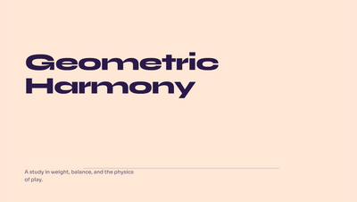

# Experiment 1 (baseline): Gemma 4 12B, 0-shot vs 3-shot

**Date:** 2026-10-23 · **Model:** gemma-4-12B-it QAT Q4_0 (llama-server, 32k ctx, vision) · **Runner:** `run_local.py --fix 2 --vision`, max 12k output tokens, temperature 0.4
**Bank at the time:** 85 entries, 61 keepers, 5 holdouts · **Retrieval:** keyword + tag overlap, always 3 examples

Planned: 5 holdout prompts × {0, 3}-shot. Stopped after 3 prompts (10 model calls) to read results.

## Side by side

<table>
  <tr><th></th><th>Claude (bank original, held out)</th><th>Gemma 4 12B (local)</th></tr>
  <tr>
    <td><b>record-stamp</b> Gemma: 0-shot, first try</td>
    <td></td>
    <td></td>
  </tr>
  <tr>
    <td><b>shape-drop-bounce</b> Gemma: 3-shot, first try</td>
    <td></td>
    <td></td>
  </tr>
</table>

**Human verdict on Gemma's best (record-stamp 0-shot):** "perfect, just timing a bit too quick, and it's bland, but it's the first of many." The stamp mechanics are right on the first try. What's missing is the time spent in motion (it's done by 0.27s) and visual richness, the same two gaps the bank's own reject reasons point at (timing, dull/look). The shape-drop 3-shot is the opposite case: real style lifted from the examples, but the shapes land off-screen at the top.

## Results

| Prompt (holdout) | 0-shot | 3-shot |
| --- | --- | --- |
| shape-drop-bounce | Shapes never appear: `gsap.set(autoAlpha: 0)` then `tl.from(autoAlpha: 1)` fades them out. Same in all 3 attempts. | Shapes visible, playful pack, contact shadows copied from `bouncy-ball-squash`, but they land on a "floor" at y = -400, half above the frame. Same in all 3 attempts. |
| record-stamp | Works on the first try: the badge slams in by 0.27s, then holds still for 89% of the runtime. Report: clean. | Badge stamps over a label and covers it to the end (report: DEFECT). Retrieved examples were unrelated templates (`vs-split`, `blob-grow-reveal`, `dropdown-unfold`) and their dark look was copied. Repair round: no answer (see 5). |
| cta-button-pop | No answer (see 5). | Not reached. |

**0-shot vs 3-shot: inconclusive** (1–1 over two prompts).

## Findings

1. **Examples transfer mechanics and style.** 3-shot fixed the `from()` misuse without being told and copied details (contact shadows, pack usage).
2. **Bad examples hurt.** Keyword retrieval matched topic words, not motion; the model copied the wrong thing faithfully.
3. **Repair rounds achieved nothing** in both prompts where they ran, because the report never named the real bug (findings 4) or the reply never arrived (finding 5).
4. **Three checker blind spots**, each frozen in `fixtures/` as a known gap:
   - an animated element that is never visible (`gemma-from-hides-subject`)
   - an element that ends cropped by its own `<svg>`/mask (`gemma-lands-on-ceiling`)
   - a long frozen final hold passes as clean (taste, not mechanics)
5. **Thinking runaway:** 2 of 9 calls spent the whole 12k budget in `reasoning_content` and returned no answer. `run_local.py` now logs reasoning.

## Next run (to beat this baseline)

- Checker: add never-visible, cropped-at-end, and long-final-hold defects; `test_checker.py` must go green on those fixtures.
- Runner: larger output budget or thinking off for repair rounds.
- Retrieval: motion tags derived from `motion.json` + a minimum match score (send 0–3 examples, not always 3).
- Evaluate retrieval changes on **fresh holdouts**, not these five, so the result isn't tuned to its own test.

Outputs: every `entries/*gemma-4-12b*` folder (status pending; `meta.json` records shots, examples, attempt, parent).
